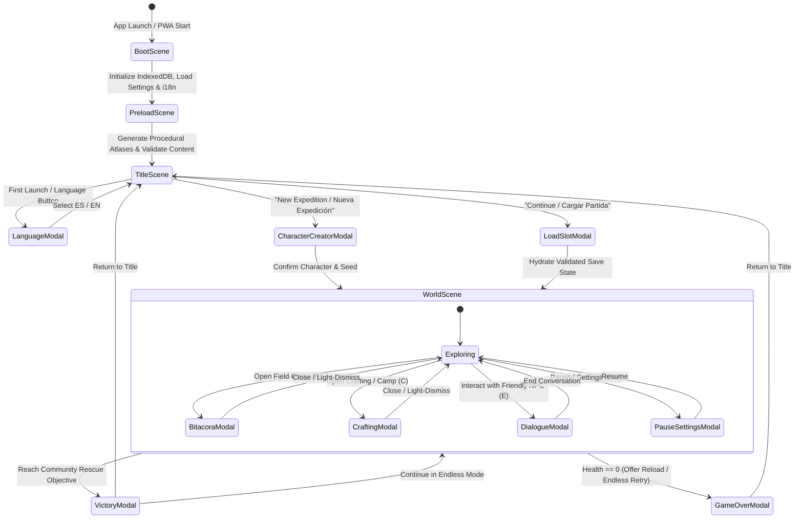
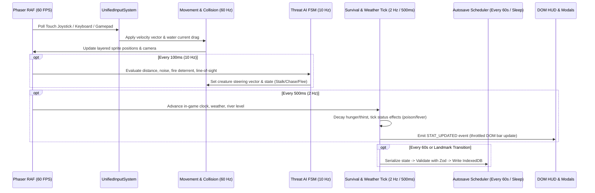
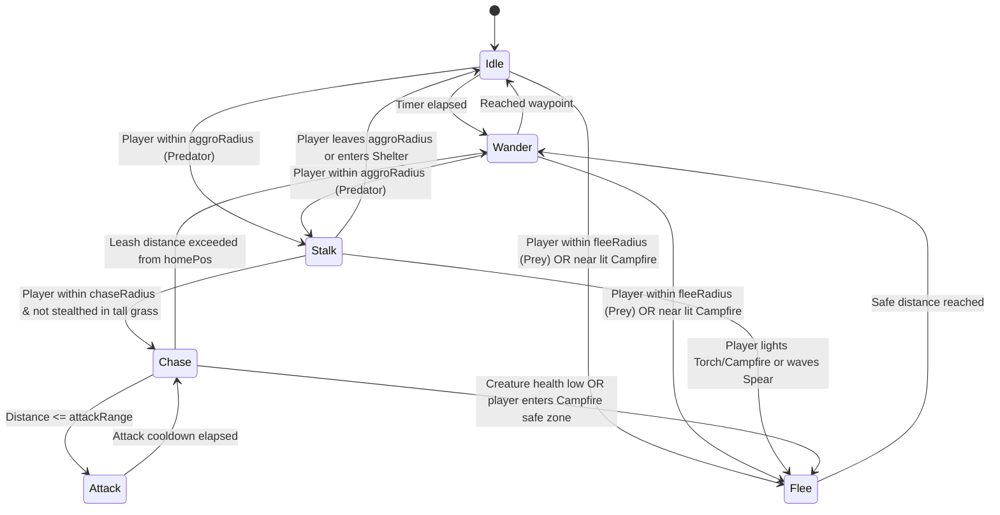

# SOFTWARE IMPLEMENTATION PLAN: "survearn" — Edition: Amazonas Colombia (Working Title: *Selva Viva*)

> **⚠️ EDUCATIONAL & SAFETY DISCLAIMER (EN):**  
> **"survearn" — Edition: Amazonas Colombia (*Selva Viva*)** is a work of educational entertainment and interactive fiction. **It is NOT a real-world wilderness survival guide, medical manual, or botanical identification tool.** Never consume, handle, or apply wild plants, fungi, insects, or animals in the real world based on information presented in this game. Many Amazonian species have deadly look-alikes or require specialized traditional preparation to remove lethal toxins.
>
> **⚠️ DESCARGO DE RESPONSABILIDAD EDUCATIVO Y DE SEGURIDAD (ES):**  
> **"survearn" — Edición: Amazonas Colombia (*Selva Viva*)** es una obra de entretenimiento educativo y ficción interactiva. **NO es una guía real de supervivencia en la selva, ni un manual médico o de identificación botánica.** Nunca consumas, manipules ni apliques plantas silvestres, hongos, insectos o animales en la vida real basándote únicamente en este juego. Muchas especies amazónicas tienen dobles mortales o requieren preparación tradicional especializada para eliminar toxinas letales.

---

## 0. Explicit Assumptions & Architectural Baseline

Before detailing the system architecture, we record the explicit engineering assumptions governing this plan and repository scaffold:

1. **Title & Branding:** The official product title is **"survearn" — Edition: Amazonas Colombia**, retaining **Selva Viva** as the internal codename and subtitle (`survearn: Selva Viva — Edición Amazonas Colombia`).
2. **Repository Root:** The project is housed in `/Users/ju4nd3r/Projects/survearn-amazonas` so that it cleanly coexists with other projects in `/Users/ju4nd3r/Projects` without polluting the home directory root.
3. **Target Audience & Content Rating:** Rated **ESRB Everyone 10+ (E10+) / PEGI 12 / Teen**. Animal and human encounters use stylized 2D pixel-art animations, knockback, and status effects without gore or graphic violence.
4. **No External Binary Asset Blobs Required for Boot:** To ensure `docker compose up` and local builds succeed deterministically out-of-the-box with zero copyright ambiguity, our asset pipeline generates crisp 16×16 pixel-art texture sheets and procedural WebAudio soundscapes at boot while supporting drop-in PNG/JSON texture atlases and OGG/MP3 audio files.
5. **Hybrid ECS + Pure Domain Logic:** All simulation math (survival decay, toxin progression, crafting validation, AI state transitions, seeded chunk generation) lives in pure TypeScript modules under `src/core/` and `src/systems/` with **zero imports from `phaser` or `window`**, enabling fast deterministic unit tests in Vitest.
6. **DOM-Over-Canvas UI Architecture:** All text-heavy interfaces (Language Selector, Character Creator, Bitácora / Field Guide, Crafting, Dialogue, Settings, Save Slots) use semantic HTML5 `<dialog>` overlays with native top-layer focus management, `closedby="any"` light-dismiss with Safari fallback, and `overscroll-behavior: contain` scroll chaining prevention, layered over a crisp integer-scaled Phaser 3 WebGL/Canvas viewport.

---

## 1. Vision, Scope, Target Audience & Design Pillars

### 1.1 Vision Statement
**survearn — Edition: Amazonas Colombia (*Selva Viva*)** is a mobile-first, offline-capable 2D top-down pixel-art survival and ethnobotanical discovery game set in the Colombian Amazon department (Leticia, Tarapaca, Puerto Nariño, Amacayacu, and Cahuinari corridors). Players step into the boots of a field expedition member separated from their river boat after a sudden *creciente* (flash seasonal river surge) and storm. To survive and reach the riverside community of **Puerto Esperanza**, the player must master real Amazonian ecology: distinguishing *yuca dulce* from lethal *yuca brava*, filtering turbid river water, building an elevated *tambo/palafito* shelter, respecting wildlife behavior, and learning from Indigenous and local riverine (*ribereño*) mentors.

### 1.2 Target Audience & Rating
- **Primary Audience:** Ages 12–35; fans of survival-crafting games (*Don't Starve*, *Terraria*, *UnReal World*, *Oregon Trail*), students, educators, and eco-curious mobile/desktop players in Latin America and worldwide.
- **Target Rating:** **ESRB E10+ / Teen** — stylized pixel-art peril, non-graphic wildlife encounters, educational depictions of illness/toxins, zero profanity or gore.

### 1.3 Core Design Pillars
1. **Knowledge is Survival (*Saber es Sobrevivir*):** Player progression is driven not just by stronger gear, but by filling the **Bitácora (Field Guide)**. Inspecting a plant reveals basic traits; talking to a local healer or processing it unlocks full scientific and culinary knowledge.
2. **Ecological Authenticity:** Every plant, fish, reptile, mammal, and craftable tool is grounded in documented Colombian Amazon biodiversity (Instituto SINCHI, Instituto Humboldt, Parques Nacionales Naturales de Colombia, IUCN).
3. **Respectful Cultural Representation:** Indigenous and local riverine peoples are portrayed as knowledgeable scientists, healers, fishers, and stewards of the forest—never as tropes or stereotypes. Hostile human encounters represent illegal extractive groups (illegal loggers/poachers) and focus on stealth, avoidance, and non-lethal deterrence.
4. **Mobile-First, Offline-First Accessibility:** Runs at 60 FPS on mid-range phones, works 100% offline as an installable PWA, supports one-handed or two-handed touch controls (plus left-handed flip), keyboard/mouse, and gamepad, and switches seamlessly between Colombian Spanish (`es`) and English (`en`).

### 1.4 Win / Lose Conditions & Dual Game Modes
- **Story / Rescue Mode ("Llegar a la Comunidad"):** Survive the trek across 3 distinct ecological zones (Terra Firme upland forest → Várzea/Igapó flooded forest → Río Amazonas main channel), earn the trust of riverine guides, craft or repair a *peque-peque* / dugout *curiara* (canoe) or signal fire at the community beacon, and reach **Puerto Esperanza** (typically 10–15 in-game days).
- **Endless Survival Mode ("Supervivencia Infinita"):** Continues after reaching the community (or selectable from start): survive as many days and seasonal flood cycles (*aguas altas* vs. *aguas bajas*) as possible while completing 100% of the Bitácora.

### 1.5 Scope Matrix — MoSCoW Prioritization (MVP vs. Later Versions)

| Category | Must Have (M0–M1 Vertical Slice & MVP) | Should Have (M2–M4 Full Core Release) | Could Have (M5 Polish & Post-Launch) | Won't Have (Out of Scope) |
| :--- | :--- | :--- | :--- | :--- |
| **Character** | Name, body type, skin tone, hair style/color, outfit, starting backpack (3 presets), layered sprite rendering, saved appearance | Unlockable hats/gear sprites visible on character | Custom pixel-art portrait editor | Complex RPG skill trees or magic spells |
| **Survival Stats** | Health, Hunger, Thirst, Stamina, Body Temp/Wetness; data-driven decay; status effects (Poison, Fever, Diarrhea, Parasites, Well-Fed) | Micro-nutrient bonus (variety of diet boosts max stamina) | Dynamic scars/fatigue animations | Complex calorie/macronutrient spreadsheet |
| **World & Biomes** | Seeded procedural chunks + authored landmarks; Terra Firme, Várzea (flooded), Riverbank & Deep Water | Seasonal river level rise (*creciente*) shifting walkable tiles into water | Subterranean caves / canopy walkways | 3D terrain or multi-planet procgen |
| **Foraging & Bitácora** | 20+ plants, 15+ animals, 10+ recipes, 8+ materials in validated JSON; searchable/filterable Bitácora with progressive reveal | Comparison view for toxic look-alikes (*yuca brava* vs *yuca dulce*) | Audio pronunciation of Indigenous/local names | Blockchain/NFT collectibles |
| **Crafting & Building** | Data-driven recipes; fire, water boiling/filtering, spear, machete, fishing trap, hammock, *tambo* shelter | Dugout canoe (*curiara*) construction & river navigation | Multi-room community research station | Automated factory conveyor belts |
| **AI & Threats** | Finite State Machine (Idle, Wander, Stalk, Chase, Attack, Flee); Jaguar, Caiman, Venomous Snake, Mosquitoes; fire deterrent | Illegal logger/poacher stealth avoidance encounters; piranha schools, army ants | Pack hunting synchronization | Graphic combat, firearms, or gore |
| **Friendly NPCs** | Dialogue trees, bartering, Bitácora hints, cultural checklist; Botanist/Healer & River Fisher | Multi-stage ecological restoration quests | Dynamic NPC daily schedules across chunks | Romance systems |
| **Platform & Ops** | Phaser 3 + TS + Vite, HTML5 `<dialog>` UI, EN/ES i18n, IndexedDB + Zod migrations, PWA, multi-stage Docker + Nginx, Vitest + Playwright | WebAudio procedural + ambient soundscape mixer | Capacitor Android/iOS native store wrapper | Multiplayer real-time PvP servers |

---

## 2. Architecture Overview

### 2.1 High-Level Layered Architecture

The system enforces a strict **unidirectional dependency rule**: `UI (DOM)` and `Rendering (Phaser Scenes)` depend on `Core Domain & ECS Systems`, which depend on `Validated Content Data & Schemas`. Core domain systems **never** import Phaser or DOM APIs.

```mermaid
flowchart TD
    subgraph Presentation["Presentation Layer (Browser / PWA)"]
        PhaserCanvas["Phaser 3 WebGL/Canvas Renderer<br/>(Tilemaps, Layered Sprites, Weather Particles, Lighting)"]
        DOMOverlays["Accessible HTML5 &lt;dialog&gt; UI Layer<br/>(Bitácora, Crafting, Character Creator, Dialogue, Settings)"]
        AudioEngine["WebAudio Ambient & SFX Synthesizer"]
        InputAdapter["Unified Input Adapter<br/>(Touch Virtual Joystick, Keyboard/Mouse, Gamepad)"]
    end

    subgraph Bridge["Event & State Bridge"]
        EventBus["Typed EventBus<br/>(Pub/Sub Cross-System Events)"]
        GameStore["Reactive Session State Store<br/>(Player, World, Inventory, Discovered Entries, Settings)"]
    end

    subgraph Domain["Pure Domain & Simulation Layer (Zero Phaser/DOM Imports)"]
        ECS["Lightweight ECS World<br/>(Entities & Pure Data Components)"]
        SurvivalSys["Survival & Status System<br/>(Hunger, Thirst, Temp, Wetness, Illness)"]
        ForageSys["Foraging & Processing System<br/>(Harvest, Cook, Detoxify Yuca Brava)"]
        CraftSys["Crafting & Shelter System<br/>(Recipe Validation, Tool Durability, Tambo Buffs)"]
        AISys["Threat AI FSM System<br/>(Idle, Wander, Stalk, Chase, Attack, Flee)"]
        WorldGenSys["Seeded Chunk & Biome Generator<br/>(Simplex/Value Noise + Authored Landmarks)"]
        WeatherSys["Weather, Day/Night & Flood System<br/>(Rain, Humidity, Mosquito Risk, River Level)"]
        DialogueSys["NPC Dialogue, Trade & Quest Engine"]
    end

    subgraph DataPersistence["Data, Localization & Persistence Layer"]
        ContentDB["Validated Static JSON Content<br/>(20 Plants, 15 Animals, 10 Recipes, 8 Materials, NPCs)"]
        I18nEngine["Typed i18n Engine<br/>(es-CO & en-US JSON Catalogs)"]
        SaveManager["IndexedDB Save & Migration Manager<br/>(Zod Schema Validation, 3 Manual Slots + Autosave, JSON Export/Import)"]
    end

    InputAdapter --> EventBus
    DOMOverlays <--> EventBus
    PhaserCanvas <--> EventBus
    AudioEngine <-- EventBus

    EventBus <--> GameStore
    GameStore <--> ECS
    ECS --> SurvivalSys
    ECS --> ForageSys
    ECS --> CraftSys
    ECS --> AISys
    ECS --> WorldGenSys
    ECS --> WeatherSys
    ECS --> DialogueSys

    SurvivalSys --> ContentDB
    ForageSys --> ContentDB
    CraftSys --> ContentDB
    AISys --> ContentDB
    WorldGenSys --> ContentDB
    DialogueSys --> ContentDB

    DOMOverlays --> I18nEngine
    PhaserCanvas --> I18nEngine
    GameStore <--> SaveManager
```

### 2.2 Scene Flow & Application Lifecycle



### 2.3 Game Loop & Fixed Simulation Tick

To keep battery usage low on mobile while maintaining 60 FPS rendering, the simulation decouples frame rendering (`requestAnimationFrame` at 60 Hz) from ecological/survival ticks:



### 2.4 Lightweight ECS Component & System Map

Rather than pulling in a heavy native C++/WASM ECS library that complicates serialization and save migrations, we implement a **serializable, type-safe Entity-Component-System (`src/core/ecs/`)** where every entity is a plain JSON-serializable object indexed by component masks:

| Component Name | Key Properties | Consumed By Systems |
| :--- | :--- | :--- |
| `PositionComponent` | `x, y, chunkX, chunkY, biomeId, inWater` | `MovementSystem`, `ChunkSystem`, `AISystem`, `WaterSystem` |
| `SpriteLayerComponent` | `baseSkin, bodyType, hairStyle, hairColor, outfit, backpack, facing` | `CharacterRenderSystem` |
| `SurvivalStatsComponent` | `health, maxHealth, hunger, thirst, stamina, bodyTemp, wetness, activeEffects[]` | `SurvivalSystem`, `ConsumableSystem`, `WeatherSystem` |
| `InventoryComponent` | `slots[], maxSlots, equippedToolId` | `InventorySystem`, `CraftingSystem`, `ForagingSystem` |
| `HarvestableComponent` | `speciesId, category, remainingYield, respawnDay, requiresTool` | `ForagingSystem`, `FieldGuideSystem` |
| `ThreatAIComponent` | `animalId, state, targetEntityId, aggroRadius, fleeRadius, fearedByFire, homePos` | `AISystem`, `CombatAvoidanceSystem` |
| `NPCComponent` | `npcId, dialogueRootId, trustLevel, tradeTableId, knownHints[]` | `DialogueSystem`, `FieldGuideSystem` |
| `StructureComponent` | `recipeId, providesShelter, isLitFire, fuelRemainingSec, waterCollectorLevel` | `ShelterSystem`, `CraftingSystem`, `AISystem` |

---

## 3. Tech Stack & Rationale (with ADR Cross-References)

Every major architectural decision is documented in `/docs/adr/ADR-001` through `/docs/adr/ADR-008`.

| Layer | Selected Technology | Rationale (2–3 Lines) | Alternatives Rejected | ADR |
| :--- | :--- | :--- | :--- | :--- |
| **2D Engine & Build** | **Phaser 3.87+ & TypeScript 5.6 (Strict) + Vite 6** | Mature 2D tilemap/sprite batching, built-in Scale Manager with integer zoom, WebAudio wrapper, and sub-second Vite HMR. Strict TypeScript prevents runtime null errors across data schemas. | **PixiJS** (requires building camera, tilemap culling, and scene lifecycle from scratch); **Kaboom/Kaplay** (less suited for large structured architectures); **Godot Web Export** (large WASM bundle, poor DOM accessibility, SharedArrayBuffer COOP/COEP friction). | `ADR-001` |
| **Architecture Pattern** | **Lightweight Serializable ECS + Pure Domain Systems + Typed EventBus** | Decouples simulation math from Phaser rendering so survival, crafting, AI, and worldgen run in Vitest in milliseconds. Plain JSON state makes save/load and schema migrations trivial. | **bitECS** (TypedArray SoA is great for 50k particles, but awkward for nested string IDs, inventory arrays, and JSON save migrations); **OOP Scene Monolith** (untestable, tight coupling). | `ADR-002` |
| **UI Layer** | **HTML5 Semantic `<dialog>` Overlays + Scoped CSS Custom Properties** | Guarantees screen-reader accessibility, keyboard focus trapping, `closedby="any"` light-dismiss, `overscroll-behavior: contain`, effortless CSS text scaling, and colorblind palettes without fighting canvas bitmap fonts. | **Phaser Canvas UI / RexUI** (poor screen-reader support, blurry text scaling on mobile, awkward scroll containers); **React/Vue** (unnecessary bundle/VDOM overhead for modal overlays). | `ADR-003` |
| **Persistence** | **IndexedDB (Custom Promise Wrapper) + Zod v3 Schema Migrations** | Asynchronous storage with ample quota for multiple save slots and chunk deltas, paired with Zod runtime validation, checksum verification, and versioned migration functions (`v1 -> v2`). | **localStorage** (synchronous main-thread blocking, 5 MB limit, no transaction safety); **Dexie.js** (extra dependency when a 90-line typed IndexedDB wrapper suffices). | `ADR-004` |
| **Content & i18n** | **Validated JSON Catalogs + Zod Build/Runtime Schemas + Typed i18n Keys** | Non-programmers and biologists can edit JSON files for species, recipes, and dialogues while `npm run validate:content` enforces scientific names, source citations, and 100% EN/ES translation parity in CI. | **Hardcoded TS Objects** (hostile to content designers and translators); **i18next** (heavy runtime features not needed when a 60-line typed dictionary with variable interpolation works). | `ADR-005` |
| **Mobile & PWA** | **`vite-plugin-pwa` (Workbox) + Dual-Mode Touch/Desktop Input + Integer Scaling** | Precaches all JSON data, code bundles, and procedural assets so the game works 100% offline in remote classrooms or travel. Responsive safe-area HUD adapts to both portrait and landscape. | **Manual Service Worker** (prone to cache-invalidation bugs on release updates); **Landscape-Only Lock** (hurts one-handed mobile usability when reading the Bitácora). | `ADR-006` |
| **Testing & Quality** | **Vitest (Unit) + Playwright (E2E) + Custom Content Validator + ESLint/Prettier** | Vitest shares Vite's pipeline for instant unit tests on survival math and migrations; Playwright verifies actual browser boot, character creation, language switching, and IndexedDB saves. | **Jest** (requires separate Babel/ts-jest transforms and struggles with ESM); **Cypress** (heavier footprint than Playwright). | `ADR-007` |
| **Containerization** | **Multi-stage Dockerfile (Node 22 Alpine → Nginx 1.27 Alpine Unprivileged)** | Produces a tiny (~25 MB) immutable production image with gzip compression, strict CSP headers, `/healthz` endpoint, and SPA routing, while `docker-compose.yml` provides `prod` (default) and `dev` profiles. | **Serving via `vite preview` in Prod** (high memory footprint, lacks hardened HTTP security headers and production static file caching). | `ADR-008` |

---

## 4. Repository Structure & Coding Conventions

### 4.1 Complete Directory Tree (`/Users/ju4nd3r/Projects/survearn-amazonas`)

```text
survearn-amazonas/
├── .dockerignore
├── .editorconfig
├── .eslintrc.cjs
├── .gitignore
├── .husky/
│   └── pre-commit
├── .github/
│   └── workflows/
│       └── ci.yml
├── .prettierrc
├── CONTRIBUTING.md
├── CREDITS.md
├── Dockerfile
├── README.md
├── docker-compose.yml
├── index.html
├── nginx/
│   └── nginx.conf
├── package.json
├── playwright.config.ts
├── tsconfig.json
├── vite.config.ts
├── docs/
│   ├── CULTURAL_ACCURACY_CHECKLIST.md
│   ├── IMPLEMENTATION_PLAN.md
│   └── adr/
│       ├── ADR-001-engine-and-build-pipeline.md
│       ├── ADR-002-ecs-and-domain-decoupling.md
│       ├── ADR-003-dom-dialog-ui-architecture.md
│       ├── ADR-004-persistence-and-schema-migrations.md
│       ├── ADR-005-content-as-validated-data-and-i18n.md
│       ├── ADR-006-mobile-first-pwa-and-controls.md
│       ├── ADR-007-testing-and-verification-strategy.md
│       └── ADR-008-containerization-and-nginx-security.md
├── public/
│   ├── favicon.svg
│   ├── pwa-192x192.svg
│   └── pwa-512x512.svg
├── scripts/
│   └── validate-content.ts
├── src/
│   ├── main.ts
│   ├── vite-env.d.ts
│   ├── assets/
│   │   ├── ProceduralAtlasGenerator.ts
│   │   └── WebAudioSynthesizer.ts
│   ├── config/
│   │   ├── constants.ts
│   │   └── tuning.json
│   ├── core/
│   │   ├── ecs/
│   │   │   ├── Entity.ts
│   │   │   └── World.ts
│   │   ├── events/
│   │   │   └── EventBus.ts
│   │   ├── math/
│   │   │   └── SeededRandom.ts
│   │   └── types/
│   │       └── game.types.ts
│   ├── data/
│   │   ├── ContentRegistry.ts
│   │   ├── schemas.ts
│   │   ├── content/
│   │   │   ├── animals.json
│   │   │   ├── biomes.json
│   │   │   ├── dialogues.json
│   │   │   ├── materials.json
│   │   │   ├── npcs.json
│   │   │   ├── plants.json
│   │   │   └── recipes.json
│   │   └── locales/
│   │       ├── en.json
│   │       └── es.json
│   ├── i18n/
│   │   └── I18nService.ts
│   ├── persistence/
│   │   ├── IndexedDBAdapter.ts
│   │   ├── SaveManager.ts
│   │   └── migrations.ts
│   ├── scenes/
│   │   ├── BootScene.ts
│   │   ├── WorldScene.ts
│   │   └── controllers/
│   │       └── InputController.ts
│   ├── styles/
│   │   └── main.css
│   ├── systems/
│   │   ├── AISystem.ts
│   │   ├── CraftingSystem.ts
│   │   ├── DialogueSystem.ts
│   │   ├── FieldGuideSystem.ts
│   │   ├── ForagingSystem.ts
│   │   ├── SurvivalSystem.ts
│   │   ├── WeatherSystem.ts
│   │   └── WorldGenSystem.ts
│   └── ui/
│       ├── UIManager.ts
│       ├── components/
│       │   ├── BitacoraModal.ts
│       │   ├── CharacterCreatorModal.ts
│       │   ├── CraftingModal.ts
│       │   ├── DialogueModal.ts
│       │   ├── HudOverlay.ts
│       │   ├── SaveSlotsModal.ts
│       │   ├── SettingsModal.ts
│       │   ├── TitleOverlay.ts
│       │   └── TouchControlsOverlay.ts
│       └── utils/
│           └── dialogHelpers.ts
└── tests/
    ├── e2e/
    │   └── smoke.spec.ts
    └── unit/
        ├── AISystem.test.ts
        ├── CraftingSystem.test.ts
        ├── SaveMigrations.test.ts
        ├── SurvivalSystem.test.ts
        └── WorldGenSystem.test.ts
```

### 4.2 Naming & Coding Conventions
- **Files:** `PascalCase.ts` for classes, scenes, systems, and UI components (`SurvivalSystem.ts`, `BitacoraModal.ts`); `camelCase.ts` for utilities and scripts (`dialogHelpers.ts`, `validate-content.ts`); `kebab-case.json` for data catalogs.
- **Identifiers:** `camelCase` for variables/functions, `PascalCase` for types/interfaces/enums, `UPPER_SNAKE_CASE` for constants and EventBus event keys.
- **Strict TypeScript:** `strict: true`, `noUncheckedIndexedAccess: true`, `noImplicitOverride: true`, zero `any` allowed.
- **Data-Driven Rule:** No numeric survival constants (hunger decay per second, poison damage, recipe ingredients) may be hardcoded in `.ts` files; all must be read from `src/config/tuning.json` or `src/data/content/*.json`.

---

## 5. Detailed Design of Core Systems

### 5.1 Character Creation & Layered Sprite System
- **Customization Attributes:**
  - `name`: String (1–24 chars, sanitized, default `"Yurupari"` or `"Amaru"`).
  - `bodyType`: `'agile' | 'sturdy' | 'balanced'` (purely cosmetic silhouette width/height tweaks on the 16×16 sprite).
  - `skinTone`: 6 realistic tones (`#f4d2b5`, `#e0ac82`, `#c68652`, `#9d6134`, `#75421e`, `#4e2a11`).
  - `hairStyle`: `'short' | 'braided' | 'curly' | 'bun'` and `hairColor`: `'black' | 'dark_brown' | 'chestnut' | 'ochre_gray'`.
  - `outfit`: `'expedition_vest' | 'river_poncho' | 'botanist_shirt'`.
  - `startingBackpack`:
    1. **Botanist's Pack (*Mochila de Botánico*):** Starts with a Magnifying Lens (+1 inspection detail tier in Bitácora) and 2 clean bandages.
    2. **River Fisher's Pack (*Mochila de Pescador*):** Starts with vegetal fiber line, 1 smoked *bocachico*, and a wooden canteen.
    3. **Pathfinder's Pack (*Mochila de Trochero*):** Starts with flint/tinder bundle and +2 inventory capacity slots.
- **Layered Rendering:** `ProceduralAtlasGenerator` composites the 4 sprite layers (`skin` + `outfit` + `hair` + `backpack`) into a cached offscreen canvas texture keyed by appearance hash so runtime rendering uses a single draw call per character frame.

### 5.2 Survival Stats & Status Effect System (`SurvivalSystem.ts`)
- **Primary Bars (0–100 scale):**
  - `health`: Reaches 0 → player collapses (rescue failed / game over prompt). Restored by medicinal plants (e.g., *Sangre de Drago* sap, *Uña de Gato* infusion) or resting while hunger/thirst > 60.
  - `hunger`: Decays at `baseHungerDecayPerSec` (scaled by difficulty and sprint activity). At 0, drains `health` slowly.
  - `thirst`: Decays faster than hunger (`baseThirstDecayPerSec`, increased during high heat). At 0, drains `health` rapidly and caps `stamina`.
  - `stamina`: Drains when sprinting, swimming against current, or chopping wood; regenerates automatically when standing/walking, scaled by hydration and warmth.
  - `bodyTemp` (34.0°C – 41.0°C, normal 37.0°C) & `wetness` (0–100%): Rain or swimming increases `wetness`; high wetness at night or during storms drops `bodyTemp` (hypothermia chill), whereas fever raises `bodyTemp`. Standing near a Campfire or resting under a *Tambo* roof dries wetness and stabilizes `bodyTemp`.
- **Status Effects (`StatusEffectId`):**
  - `food_poisoning`: Caused by eating raw toxic tubers/fungi (e.g., unprocessed *Yuca Brava* cyanogenic glycosides). Rapidly drains health and thirst; cured by activated charcoal from campfire + hydration or *Guayusa* purge.
  - `parasites` / `diarrhea`: Caused by drinking unboiled/unfiltered river or stagnant *várzea* water. Doubles thirst decay for 2 in-game days; treated with *Ajo de Monte* or *Semillas de Papaya Silvestre*.
  - `malaria_fever`: Risk accumulates when exposed at dusk/night in high-humidity/flooded zones without smoke, shelter, or *Caruto/Huito* (*Genipa americana*) skin repellent. Causes periodic stamina drops and elevated `bodyTemp`; treated with *Quina* (*Cinchona pubescens*) bark decoction.
  - `venom_bite`: Triggered by venomous snake (*Bothrops atrox* / Talla Equis) or poison dart frog handling without protection. Requires rest, immobilization, and poultice stabilization while seeking the community healer.
  - `well_fed`: Granted after eating cooked meals (e.g., *Casabe* + roasted *Pirarucú*). Slows stamina drain by 25%.

### 5.3 Foraging, Processing & Discovery System (`ForagingSystem.ts`)
- Resource nodes spawn per biome according to weighted spawn tables (`biomes.json`).
- **Inspection before Harvest:** Tapping/pressing `Inspect` (`I` or magnifying glass button) reveals the node's morphological clue (e.g., *"Reddish peeling bark with bitter sap"* or *"Palmate leaves with brittle reddish petiole — could be Yuca Brava or Yuca Dulce"*).
- **Processing Chains:**
  - **Raw Bitter Cassava (*Manihot esculenta* — Yuca Brava)** has `edibility: "toxic_raw"` and `requiresProcessing: "grate_press_toast"`. Eating it raw inflicts severe `food_poisoning` (cyanide toxicity). Processing it at a camp with a woven fiber press (*tipití*) and clay griddle (*budare*) over fire transforms it into **Casabe (Cassava Flatbread)**, a non-perishable high-hunger staple.
  - **Raw River Water** → boiled over Campfire in a clay/gourd vessel → **Safe Boiled Water**.

### 5.4 Field Guide ("Bitácora / Enciclopedia") (`FieldGuideSystem.ts`)
- Every plant, animal, material, and recipe has a corresponding Bitácora card.
- **3-Tier Progressive Knowledge State per Entry:**
  1. `unknown` (0%): Silhouette and `"???"` until first encountered in the world.
  2. `observed` (50%): Unlocked on first inspection or sighting. Shows Common Name (ES/EN), Scientific Name (Latin), Habitat, and a cautionary field hint.
  3. `mastered` (100%): Unlocked after safely harvesting/processing, experiencing its effect, or receiving wisdom from a friendly NPC. Reveals exact Edibility/Toxicity badge, Medicinal/Crafting uses, Fun Fact, and Scientific Literature Source (SINCHI / Humboldt / IUCN).
- **Search & Filter UI:** Instant text search (matches Spanish, English, or Latin scientific names) + category tabs (`All`, `Plants`, `Animals`, `Materials`, `Recipes`) + status filter (`Edible`, `Medicinal`, `Toxic/Dangerous`, `Discovered`).

### 5.5 Crafting & Shelter Building (`CraftingSystem.ts`)
- Data-driven recipe definitions in `src/data/content/recipes.json`.
- Each recipe specifies:
  - `id`, localized `name` and `description`, `category` (`tool`, `camp`, `processing`, `medicine`, `transport`).
  - `ingredients`: Array of `{ itemId, count }`.
  - `requiredStation`: `'none' | 'campfire' | 'shelter_workbench'`.
  - `unlockCondition`: Default unlocked or unlocked via Bitácora / NPC teaching.
- **Placed World Structures:**
  - **Campfire (*Fogata*):** Boils water, cooks fish/tubers, dries wetness, provides light at night, and forces nocturnal predators (Jaguar, Caiman) within 5 tiles into the `flee` state. Consumes firewood; extinguished by heavy storms unless placed under a *Tambo*.
  - **Tambo / Palafito Shelter:** Elevated wooden platform with woven *Moriche*/*Asaí* palm thatch roof. Protects campfires from rain, enables sleeping to advance time and heal, and reduces nocturnal mosquito bite probability by 80%.
  - **Dugout Canoe (*Curiara / Potrillo*):** Allows safe traversal of deep river channels and fast travel toward the rescue community.

### 5.6 Weather, Day/Night Cycle & Seasonal Flooding (`WeatherSystem.ts`)
- **In-Game Clock:** 1 real-time minute = 1 in-game hour (24 real minutes per full day/night cycle; configurable in `tuning.json`).
  - **Dawn (05:00–07:00):** Mist, high bird/fish activity.
  - **Day (07:00–17:30):** Full visibility, peak heat between 12:00–15:00 (+25% thirst decay).
  - **Dusk (17:30–19:00):** Golden-purple lighting tint, peak mosquito activity.
  - **Night (19:00–05:00):** Reduced vision radius around player (expanded by torch/campfire), nocturnal predators (*Panthera onca*, *Bothrops atrox*, *Caiman niger*) become active.
- **Weather States:** `clear`, `humid_haze`, `tropical_rain`, `heavy_storm`.
- **Seasonal River Rise (*Pulso de Inundación*):** `riverLevel` fluctuates between `0.0` (low water beaches exposed) and `1.0` (high water *várzea* flooded). Tiles with elevation `< riverLevel` dynamically transition from walkable riverbank mud to shallow/deep water.

### 5.7 Threat AI & Avoidance System (`AISystem.ts`)
Every mobile creature runs a deterministic Finite State Machine evaluated at 10 Hz:



- **Wildlife Behavior Distinctions:**
  - **Jaguar (*Panthera onca*):** Apex ambush predator. Uses `Stalk` (moves slowly when player looks away, pauses when player faces it) before `Chase`. Strongly deterred by fire (`fearedByFire: true`).
  - **Black Caiman (*Melanosuchus niger*) & Green Anaconda (*Eunectes murinus*):** Patrol riverbanks and *várzea* shallows; fast in water, sluggish on dry land.
  - **Fer-de-Lance / Talla Equis (*Bothrops atrox*):** Defensive ambush reptile (`Idle` coiled in leaf litter). Does not chase across the map—only strikes if the player steps within 1.2 tiles without inspecting or clearing brush with a machete.
  - **Illegal Loggers / Poachers (Optional Human Threat):** Patrol near scarred forest clearings. Non-graphic mechanic: if spotted, they blow a warning whistle and pursue to confiscate tools/supplies, encouraging stealth in dense foliage or distraction.

### 5.8 Friendly NPCs, Dialogue, Bartering & Cultural Checklist (`DialogueSystem.ts`)
- **Initial Friendly NPCs:**
  1. **Abuela Sabina (Uitoto/Tikuna Ethnobotanist & Healer):** Resides at a riverside *chagra* (traditional agroforestry garden). Teaches the difference between *Yuca Brava* and *Yuca Dulce*, unlocks medicinal Bitácora entries (*Sangre de Drago*, *Quina*, *Copoazú*), and trades processed *Casabe* for rare forest resins.
  2. **Mateo (Riverine Fisher / *Pescador Ribereño*):** Found near the várzea channel. Teaches sustainable fishing (*nasa* trap vs. overharvesting juvenile *Pirarucú*), warns about seasonal *crecientes*, and provides the quest clue to signal or reach **Puerto Esperanza**.
  3. **Dra. Valentina Ruiz (SINCHI Field Biologist):** Studies amphibians and water quality at a field camp. Trades water purification tablets/filters for completed Bitácora observations.

### 5.9 Water Zones & Hydrological Mechanics
- **3 Water Depth Tiers:**
  - **Riverbank / Flooded Várzea Shallows:** Walkable at 65% movement speed; increases `wetness` to 40%; prime habitat for *Asaí*, *Moriche*, and *Capibara*.
  - **Swimmable River / Oxbow Lake (*Cocha*):** Consumes stamina per second; exposes player to *Pygocentrus nattereri* (red-bellied piranha) if player has an active bleeding status or splashes excessively; fishing spots spawn here.
  - **Deep Main Channel (*Río Amazonas*):** Strong downstream current vector (`+vx`); requires a crafted **Canoe (*Curiara*)** for safe prolonged travel.

### 5.10 Procedural + Authored Hybrid World Generation (`WorldGenSystem.ts`)
- **Deterministic Seeded PRNG:** Uses a `Mulberry32` + 2D value/simplex noise generator (`SeededRandom.ts`) seeded from a user-visible string (e.g., `"AMAZONAS-2026"`).
- **Chunk Architecture:** World is partitioned into `16 × 16` tile chunks (`1 tile = 16×16 px` base resolution). Only the `3 × 3` chunk neighborhood around the player is active in Phaser's tilemap renderer; distant chunks are unloaded and only their delta modifications (harvested nodes, built structures) are persisted in save data.
- **Authored Landmarks Pinning:** Chunk `(0, 0)` always generates the **Stranded Riverbank Starting Clearing** with guaranteed access to fresh water, edible *Asaí* palm, cautionary *Yuca Brava*, a friendly mentor nearby, and a patrolling Jaguar territory to the north, ensuring the M1 vertical slice and new player onboarding are never soft-locked by RNG.

### 5.11 Localization (`I18nService.ts`)
- Runtime switchable between `es` (Colombian Spanish — primary narrative voice using natural regional terms like *bitácora, chagra, tambo, quebrada, várzea, trocha*) and `en` (English).
- Scientific names (`Euterpe precatoria`, *Panthera onca*, *Manihot esculenta*) remain invariant in Latin across all locales and are rendered in *italics*.
- Build-time CI script (`scripts/validate-content.ts`) verifies that `es.json` and `en.json` have identical key trees and zero empty strings.

### 5.12 UI/UX & Mobile-First Wireframes

#### Landscape / Desktop Layout
```text
+-----------------------------------------------------------------------+
| [HP ❤️ 95%] [Food 🍍 80%] [Water 💧 72%] [Stam ⚡]  | ☀️ Day 1 10:30 🌧️ |
| [Temp 37.0°C | Wet 15%] [Status: Well-Fed]         | [📖 Bitácora (B)] |
|                                                    | [🔨 Craft (C)]    |
|                                                    | [⚙️ Menu (Esc)]   |
|                        PHASER 3 GAME CANVAS                           |
|                     (Integer-Scaled Pixel Art)                        |
|                                                                       |
|       ( (o) )                                      [🔍 Inspect (I)]   |
|    Virtual Joystick                                [🖐️ Action (E/Spc)]|
|  [Slot 1: Machete] [Slot 2: Asaí x3] [Slot 3: Canteen] [Slot 4: Wood] |
+-----------------------------------------------------------------------+
```

#### Portrait Mobile Layout (Safe-Area Aware)
```text
+-----------------------------------+
| ❤️95%  🍍80%  💧72%  ⚡90%  🌡️37°C | <- Compact Top Status Bar
| ☀️ Día 1 - 10:30 | Várzea         |
+-----------------------------------+
|                                   |
|                                   |
|       PHASER 3 GAME CANVAS        |
|     (Centered on Explorer)        |
|                                   |
|                                   |
+-----------------------------------+
| [1:Machete] [2:Asaí] [3:Agua] [4] | <- Quick Inventory Strip
| [📖 Guía] [🔨 Crear] [💾] [⚙️]    | <- Modal Trigger Bar
|                                   |
|   ( (o) )            [🔍]   [🖐️]  | <- Thumb-Zone Joystick & Actions
|  (Flips in Left-Handed Mode)      |
+-----------------------------------+
```

---

## 6. Data Model & JSON Schemas (Zod Validated)

All schemas are defined in `src/data/schemas.ts` and validated both at build time (`npm run validate:content`) and when importing save files.

### 6.1 Plant / Flora Schema (`PlantSpeciesSchema`)
```typescript
{
  id: string; // e.g., "euterpe_precatoria_asai"
  scientificName: string; // "Euterpe precatoria"
  commonName: { es: string; en: string };
  biomeIds: ("terra_firme" | "varzea" | "riverbank" | "aquatic")[];
  edibility: "edible_raw" | "edible_processed" | "medicinal" | "toxic";
  requiresProcessing?: "cook" | "grate_press_toast" | "boil_decoction";
  processedItemId?: string;
  effectsOnConsumeRaw: {
    healthDelta: number;
    hungerDelta: number;
    thirstDelta: number;
    staminaDelta: number;
    addStatusEffect?: "food_poisoning" | "well_fed";
    cureStatusEffect?: "parasites" | "malaria_fever" | "food_poisoning" | "venom_bite";
  };
  inspectionHint: { es: string; en: string };
  howToUse: { es: string; en: string };
  funFact: { es: string; en: string };
  sources: string[]; // e.g., ["Instituto SINCHI (2018) - Palmas útiles de la Amazonia colombiana"]
  spriteTint: string; // Hex color for procedural pixel sprite
}
```

### 6.2 Animal / Fauna Schema (`AnimalSpeciesSchema`)
```typescript
{
  id: string; // e.g., "panthera_onca_jaguar"
  scientificName: string; // "Panthera onca"
  commonName: { es: string; en: string };
  biomeIds: ("terra_firme" | "varzea" | "riverbank" | "aquatic")[];
  threatLevel: "harmless_prey" | "defensive_hazard" | "ambush_predator" | "disease_vector";
  aiProfile: {
    moveSpeed: number;
    aggroRadius: number;
    fleeRadius: number;
    attackDamage: number;
    inflictsStatus?: "venom_bite" | "malaria_fever";
    fearedByFire: boolean;
  };
  yieldItems: { itemId: string; count: number }[];
  inspectionHint: { es: string; en: string };
  behaviorNote: { es: string; en: string };
  funFact: { es: string; en: string };
  sources: string[];
}
```

### 6.3 Save File Schema (`SaveFileSchema` — Version 2 with V1 Migration)
```typescript
{
  schemaVersion: 2;
  saveSlotId: "autosave" | "slot_1" | "slot_2" | "slot_3";
  savedAtISO: string;
  checksum: string; // FNV-1a integrity hash of payload
  worldSeed: string;
  dayCount: number;
  timeOfDayMinutes: number; // 0..1439
  weather: "clear" | "humid_haze" | "tropical_rain" | "heavy_storm";
  riverLevel: number; // 0.0..1.0
  difficulty: "explorer" | "survivalist" | "amazon_realist";
  character: {
    name: string;
    bodyType: "agile" | "sturdy" | "balanced";
    skinTone: string;
    hairStyle: "short" | "braided" | "curly" | "bun";
    hairColor: string;
    outfit: "expedition_vest" | "river_poncho" | "botanist_shirt";
    startingBackpack: "botanist" | "fisher" | "pathfinder";
  };
  playerState: {
    x: number;
    y: number;
    stats: {
      health: number;
      hunger: number;
      thirst: number;
      stamina: number;
      bodyTemp: number;
      wetness: number;
      activeEffects: { id: string; remainingSec: number }[];
    };
    inventory: { itemId: string; count: number }[];
    discoveredSpecies: Record<string, "observed" | "mastered">;
    builtStructures: { id: string; recipeId: string; x: number; y: number }[];
    harvestedNodes: string[]; // deterministic node keys "chunkX:chunkY:nodeIdx"
  };
}
```

---

## 7. Performance & Accessibility Plan

### 7.1 Mobile Performance Budgets & Techniques
- **Frame Time Budget:** `< 16.6 ms` (60 FPS target on mid-range Snapdragon 6-series / Apple A13 devices), with an optional **30 FPS Battery Saver Cap** in Settings.
- **Chunk Loading & Culling:** Only tiles and entities within a `3 × 3` chunk window (`48 × 48` tiles) around the player are instantiated as Phaser GameObjects. Entities outside the active window are hibernated in plain data arrays.
- **Single Dynamic Texture Atlas:** `ProceduralAtlasGenerator` packs all 16×16 terrain tiles, flora sprites, fauna sprites, and UI icons into a single WebGL texture atlas at startup to keep WebGL draw calls `< 15` per frame.
- **Throttled DOM Updates:** HUD progress bars update only when a stat changes by `>= 0.5%` or on the 500ms simulation tick, using `transform: scaleX()` / CSS custom properties to avoid layout thrashing.

### 7.2 Accessibility Plan (WCAG 2.1 AA Aligned)
- **Native `<dialog>` Modals:** All menus use `<dialog closedby="any">` opened via `.showModal()`, providing automatic screen-reader landmarks (`aria-labelledby`), focus trapping, `Esc` dismissal, and `overscroll-behavior: contain` on both `dialog:modal` and `dialog::backdrop`.
- **Colorblind-Friendly Mode:** Never relies on red vs. green alone to indicate edible vs. toxic plants; pairs colors with distinct shapes/icons (`✓` leaf badge for edible, `✚` cross for medicinal, `⚠️` triangle for toxic) and shifts HUD palette to an Okabe-Ito deuteranopia/protanopia-safe palette when toggled.
- **Text Size Scaling:** Settings menu supports `100%`, `115%`, and `130%` root font scaling via CSS custom property `--ui-font-scale`.
- **Reduce Motion Mode:** Disables camera screen-shake, lightning flashes, and rapid water wave oscillations.
- **Left-Handed Touch Mode:** Mirrors the bottom-screen virtual joystick (to bottom-right) and action buttons (to bottom-left).

---

## 8. Testing, CI/CD, Docker & Deployment Strategy

### 8.1 Multi-Layer Testing Pyramid
1. **Static & Content Validation (`npm run validate:content`):** Validates all 20+ plants, 15+ animals, 10+ recipes, 8+ materials, NPCs, and dialogues against Zod schemas, checks referential integrity (every recipe ingredient exists), and verifies 100% key parity between `es.json` and `en.json`.
2. **Unit Tests (`npm run test:unit` via Vitest):**
   - `SurvivalSystem.test.ts`: Decay rates, dehydration damage, hypothermia, raw *Yuca Brava* poisoning vs. cooked *Casabe* recovery.
   - `CraftingSystem.test.ts`: Ingredient consumption, station requirements (*Fogata* for boiling water), inventory capacity checks.
   - `AISystem.test.ts`: Jaguar `Idle -> Stalk -> Chase -> Attack` transitions and immediate transition to `Flee` when near a lit campfire.
   - `SaveMigrations.test.ts`: Upgrading a `v1` legacy save payload to `v2`, verifying checksum tamper detection and corrupt save recovery.
   - `WorldGenSystem.test.ts`: Seed determinism (same seed produces identical biome and resource layouts).
3. **End-to-End Smoke Tests (`npm run test:e2e` via Playwright):**
   - Boots the compiled app in headless Chromium, switches language between Español and English, creates a custom character, enters the Amazon world, harvests an edible *Asaí* fruit, unlocks the Bitácora entry, opens Settings, saves the game, reloads the page, and verifies state persistence.

### 8.2 CI/CD Pipeline (`.github/workflows/ci.yml`)
- Triggered on `push` and `pull_request` to `main`.
- **Jobs:**
  1. `lint-and-validate`: Runs `npm ci`, `npm run lint`, `npm run typecheck`, `npm run validate:content`, and `npm audit --audit-level=high`.
  2. `unit-tests`: Runs `npm run test:unit -- --coverage`.
  3. `build-and-e2e`: Builds production bundle (`npm run build`), installs Playwright Chromium, runs `npm run test:e2e`.
  4. `docker-build`: Builds the multi-stage Docker image, starts the container, and verifies HTTP `200 OK` on `http://localhost:8080/healthz`.

### 8.3 Containerization & Security (`Dockerfile`, `docker-compose.yml`, `nginx.conf`)
- **Stage 1 (`builder`):** `node:22-alpine` — installs dependencies, runs `validate:content` and `vite build`.
- **Stage 2 (`runner`):** `nginxinc/nginx-unprivileged:1.27-alpine` — runs as non-root UID `101` on port `8080` (mapped to `8080:8080` in `docker-compose.yml`).
- **Nginx Configuration (`nginx/nginx.conf`):**
  - Enables `gzip on` for JS, CSS, JSON, SVG, and WASM.
  - Long-term immutable caching (`Cache-Control: public, max-age=31536000, immutable`) for hashed `/assets/*`, and `no-cache` for `index.html`, `sw.js`, and `manifest.webmanifest`.
  - Strict Content-Security-Policy (`default-src 'self'; script-src 'self'; style-src 'self' 'unsafe-inline'; img-src 'self' data: blob:; media-src 'self' data: blob:; connect-src 'self'; object-src 'none'; frame-ancestors 'none';`).
  - Dedicated `/healthz` endpoint returning `200 OK`.
- **Single-Command Launch:**
  - `docker compose up --build` → builds and starts the production container at `http://localhost:8080`.
  - `docker compose --profile dev up` → runs the Vite hot-reload dev server at `http://localhost:5173`.

---

## 9. Risk Register, Cultural Sensitivity & Asset Licensing

### 9.1 Risk Register

| ID | Risk Description | Likelihood | Impact | Mitigation Strategy |
| :--- | :--- | :---: | :---: | :--- |
| **R-01** | **Real-World Foraging Misuse:** Players attempt to eat wild plants based on in-game visuals. | Low | Critical | Prominent bilingual safety disclaimer on Title Screen, in Bitácora header, and in `README.md`. Emphasize look-alikes (*yuca brava*). |
| **R-02** | **Cultural Misrepresentation:** Indigenous or riverine NPCs depicted with inaccurate stereotypes. | Medium | High | Enforce `/docs/CULTURAL_ACCURACY_CHECKLIST.md`; depict NPCs as contemporary knowledge holders and scientists; attribute ethnobotanical sources (SINCHI/Humboldt). |
| **R-03** | **Mobile Performance Drops in Rain/Water:** Heavy particle effects cause FPS drops on low-end phones. | Medium | Medium | Cap rain particles to a pooled array of 60 sprites, offer 30 FPS / Low Graphics toggle, and disable shaders in Reduce Motion mode. |
| **R-04** | **Corrupted IndexedDB Save Data:** Browser crash or manual edit breaks save JSON. | Low | High | Compute FNV-1a checksum on save, keep previous backup slot (`autosave_backup`), validate with Zod on load, and provide safe fallback + JSON file export/import. |
| **R-05** | **Offline PWA Cache Stale After Update:** Service worker serves outdated code after a new deployment. | Medium | Low | Configure Workbox `registerType: 'autoUpdate'` with `skipWaiting` and `clientsClaim`, plus `no-cache` headers on `sw.js`. |

### 9.2 Cultural & Biological Accuracy Review Process
Documented in `/docs/CULTURAL_ACCURACY_CHECKLIST.md`:
1. **Botanical & Zoological Verification:** Every species entry must cite at least one recognized scientific authority (Catálogo de Plantas y Líquenes de Colombia, Instituto Amazónico de Investigaciones Científicas SINCHI, Instituto Humboldt, or IUCN Red List).
2. **Respectful Attribution of Traditional Knowledge:** When a medicinal or culinary preparation (such as detoxifying *Manihot esculenta* via *tipití* and *budare* to make *casabe*) stems from Indigenous Amazonian science (Uitoto, Tikuna, Cocama, Yagua, Bora), explicitly credit that heritage in the Bitácora entry.
3. **Zero Exoticization:** Avoid "mystical/primitive" tropes; portray local healers, fishers, and researchers as skilled practitioners using empirical ecological knowledge.
4. **Expert Validation Gate:** Prior to public educational distribution (`M5`), submit `plants.json`, `animals.json`, and `dialogues.json` for review by Colombian Amazonian ethnobotanists and cultural liaisons.

### 9.3 Asset & Audio Licensing Strategy (`CREDITS.md`)
- All pixel art in the repository is generated procedurally by `src/assets/ProceduralAtlasGenerator.ts` using our custom 32-color **Amazonia Pixel Palette** (inspired by canopy greens, river ochres, and tropical fruits) under **CC0 / MIT**.
- All ambient soundscapes (rain patter, river current, bird calls, UI clicks) are synthesized in real time via the Web Audio API (`src/assets/WebAudioSynthesizer.ts`), requiring zero external proprietary audio files while supporting external CC0/CC-BY `.ogg` overrides.

---

## 10. Roadmap & Milestones (M0 – M5)


| Milestone | Duration | Key Deliverables | Dependencies | Definition of Done (Acceptance Criteria) |
| :--- | :---: | :--- | :---: | :--- |
| **M0: Foundation & DevOps** | 1 Week | Repo scaffold, Vite + TS strict config, ESLint/Prettier, ADRs 001–008, Dockerfile + Nginx + Compose, CI workflow, Zod schemas | None | `npm run lint`, `npm run typecheck`, `npm run validate:content`, and `docker compose build` pass with 0 errors. |
| **M1: Playable Vertical Slice** | 2 Weeks | Boot, Language toggle (ES/EN), Character Creator (layered sprites), seeded jungle + river map, touch/keyboard movement, decaying hunger/thirst, edible (*Asaí*) + toxic (*Yuca Brava*) foraging, Bitácora unlock, Jaguar FSM AI, Settings, IndexedDB save/load + autosave | M0 | Playable end-to-end in browser & Docker; Vitest unit tests and Playwright smoke test pass. |
| **M2: Survival, Processing & Crafting** | 2 Weeks | Body temp/wetness simulation, campfire, water boiling/filtration, *Yuca Brava* processing into *Casabe*, *Tambo* shelter building, 10 craftable recipes | M1 | Player can survive night storms under a built *Tambo*, detoxify *Yuca Brava*, and boil river water. |
| **M3: Biomes, Water Zones & NPCs** | 2 Weeks | Multi-chunk streaming, seasonal river rise (*várzea* flooding), swimming/currents, Caiman/Snake/Mosquito AI, friendly NPC dialogue trees & bartering (Abuela Sabina, Mateo, Dra. Valentina), rescue objective | M2 | Player can trade with NPCs, receive Bitácora hints, craft a canoe or signal fire, and complete the Rescue objective. |
| **M4: Full Content Seed & Bitácora** | 2 Weeks | 20+ plants, 15+ animals, 10+ recipes, 8+ materials with SINCHI/Humboldt citations; Bitácora search, category/status filters, and 3-tier knowledge progression | M3 | `npm run validate:content` confirms >= 20 plants, >= 15 animals, >= 10 recipes, >= 8 materials with 100% EN/ES parity. |
| **M5: PWA, Accessibility & Hardening** | 1 Week | Offline Service Worker caching, colorblind Okabe-Ito mode, reduce-motion, text scaling, left-handed touch layout, save JSON export/import, WebAudio synthesizer | M4 | Lighthouse PWA & Accessibility >= 95; 60 FPS on mobile emulation; full offline boot verified. |

---

## 11. Backlog of GitHub-Style Issues / User Stories (M0 & M1)

### Milestone M0 Issues
- **ISSUE-001 [M0]: Initialize TypeScript + Vite + Phaser 3 Strict Workspace & Quality Tooling**
  - *User Story:* As a developer, I want a strict TypeScript + Vite + ESLint + Prettier workspace so code quality is enforced automatically.
  - *Acceptance Criteria:* `tsconfig.json` has `"strict": true`; `npm run typecheck` and `npm run lint` exit 0.
- **ISSUE-002 [M0]: Author Architecture Decision Records (ADR-001 to ADR-008)**
  - *User Story:* As an architect, I want every core technical trade-off documented in `/docs/adr/` so contributors understand our constraints.
  - *Acceptance Criteria:* 8 markdown ADRs exist covering Engine, ECS, DOM UI, IndexedDB+Zod, Content/i18n, Mobile PWA, Testing, and Docker/Nginx.
- **ISSUE-003 [M0]: Create Zod Content Schemas & CI Validation Script (`validate-content.ts`)**
  - *User Story:* As a content designer, I want automated schema validation for plants, animals, recipes, materials, NPCs, and EN/ES locales.
  - *Acceptance Criteria:* `npm run validate:content` validates all JSON catalogs, checks cross-references, and fails with clear line messages if keys are missing.
- **ISSUE-004 [M0]: Build Multi-Stage Production Dockerfile, Unprivileged Nginx & Docker Compose**
  - *User Story:* As an operator, I want to run the game with a single `docker compose up` command served by a hardened Nginx container.
  - *Acceptance Criteria:* Multi-stage Dockerfile builds static assets and serves via `nginxinc/nginx-unprivileged` on port 8080 with gzip, CSP headers, SPA fallback, and `/healthz` healthcheck.

### Milestone M1 Issues
- **ISSUE-005 [M1]: Implement Runtime Localization Service (`es` / `en`) & Disclaimer Banner**
  - *User Story:* As a player in Colombia or abroad, I want to switch between Spanish and English at any time and read the safety disclaimer.
  - *Acceptance Criteria:* Language switch updates all UI modals, HUD labels, and Bitácora entries immediately without reloading the page.
- **ISSUE-006 [M1]: Build Character Creator with Layered Pixel-Art Sprite Compositor**
  - *User Story:* As a player, I want to customize my explorer's name, body type, skin tone, hair, outfit, and starting backpack, and see it reflected on my character sprite.
  - *Acceptance Criteria:* Selecting options updates the live preview and generates the layered sprite sheet persisted in the save file.
- **ISSUE-007 [M1]: Implement Seeded World Generator & Hybrid Riverbank Starting Chunk**
  - *User Story:* As a player, I want to explore a lush Amazonian landscape with terra firme forest, flooded várzea, and a flowing river that is reproducible from a seed.
  - *Acceptance Criteria:* `WorldGenSystem` deterministically generates biomes, river currents, flora nodes, and landmarks from `worldSeed`.
- **ISSUE-008 [M1]: Implement Dual Input Controller (Touch Virtual Joystick + Keyboard/Gamepad)**
  - *User Story:* As a mobile or desktop player, I want responsive movement and context action buttons that adapt to portrait, landscape, and left-handed preferences.
  - *Acceptance Criteria:* Touch joystick and action buttons work smoothly on mobile viewports; WASD/Arrow keys + E/I/B/C work on desktop.
- **ISSUE-009 [M1]: Implement Data-Driven Survival Stats & Foraging Consequences**
  - *User Story:* As a player, I want my hunger, thirst, stamina, and temperature to respond to the environment and what I eat or drink.
  - *Acceptance Criteria:* Eating raw *Asaí* restores hunger/thirst safely; eating raw *Yuca Brava* inflicts `food_poisoning`; drinking raw river water risks `parasites`; boiling/processing makes them safe.
- **ISSUE-010 [M1]: Implement Searchable & Filterable Bitácora (Field Guide) Modal**
  - *User Story:* As a learner, I want my Bitácora to unlock species entries as I inspect, harvest, or discuss them with NPCs, showing scientific names and sources.
  - *Acceptance Criteria:* Inspecting or harvesting a plant unlocks its Bitácora card; search input and category/status pills filter entries in real time.
- **ISSUE-011 [M1]: Implement Threat AI State Machine (Jaguar, Caiman, Snake) & Fire Deterrent**
  - *User Story:* As a survivor, I want Amazonian predators to behave realistically—stalking, chasing, or fleeing from campfires—so I can use stealth and tools to survive.
  - *Acceptance Criteria:* Jaguar transitions through `Idle -> Wander -> Stalk -> Chase -> Attack`, and transitions to `Flee` when entering a lit campfire's radius.
- **ISSUE-012 [M1]: Implement Versioned IndexedDB Save System with Autosave, 3 Manual Slots & File Export**
  - *User Story:* As a player, I want my progress saved automatically and across 3 manual slots, with the ability to export/import my save file.
  - *Acceptance Criteria:* Autosave triggers periodically and on rest; manual slots 1–3 save/load full world and character state; Zod migration upgrades `v1` saves to `v2`.
